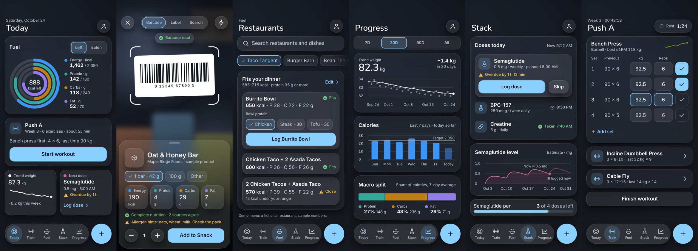

# Helios (repository: Caliber-DEV)

Helios is one iOS app for three jobs that usually need three apps: macro tracking, peptide and protocol tracking, and weight training, with charts that show how they relate. The app itself is built in the owner's Xcode project. This repository holds everything that can be written and verified without it: the build brief, the engines, the design system and CI.



"Helios" is a working name and still needs trademark clearance.

## What is here

| Path | What it is |
| --- | --- |
| `docs/ASTRA_MASTER_PROMPT.md` | The build brief for the app. |
| `docs/FOOD_SCANNING.md` | How barcodes, product lookup and nutrition-label reading work, and what to check on a real device. |
| `docs/RESTAURANT_LIBRARY.md` | The restaurant library: schema, CSV import, search, macro-fit finder, and where real data can legitimately come from. |
| `docs/DESIGN.md` | The design system: the Graphite and Frost themes, glass rules, accessibility gates, and how to use it. |
| `design/tokens.json` | The single source for colours, radii, spacing, type roles and motion. Swift and CSS are generated from it. |
| `design/lookbook/` | Six screens per theme, palettes and accessibility modes as plain HTML. Open `index.html`. |
| `Packages/HeliosTime`, `TrainingCore`, `NutritionCore`, `StackCore`, `InsightsCore` | Pure Swift engines: time, training maths, nutrition targets, the protocol calculator and schedule, insights. |
| `Packages/FoodCore`, `RestaurantCore` | Barcode, product-lookup, label-reading and restaurant-library engines. No real chain's nutrition data is bundled. |
| `Packages/HeliosDesign` | The palettes, their audit, and the SwiftUI kit. |
| `scripts/` | The token generator, the look-book check and the Dynamic Type lint, with their tests. |

## Checks

```
python3 scripts/gen_tokens.py --check                 # generated Swift and CSS match tokens.json
python3 scripts/check_lookbook.py                     # the look book uses real tokens and prints real numbers
python3 -m unittest discover -s scripts -p 'test_*.py'
python3 scripts/lint_dynamic_type.py                  # no fixed-size text
(cd Packages/FoodCore && swift test)                  # any package
```

`.github/workflows/ios-ci.yml` runs the Python checks on Linux and `swift test` in every package on macOS 14 (Xcode 15.4) and the latest macOS image, on every push.

## What has not been checked

- Real data. Product lookups were written against the documented Open Food Facts and USDA formats, not live responses, and no real restaurant menu was loaded.
- Anything that needs hardware: the camera scanner, label reading on real packaging, and how the SwiftUI layer looks and behaves on a device.
- The app code. It lives outside this repository.
