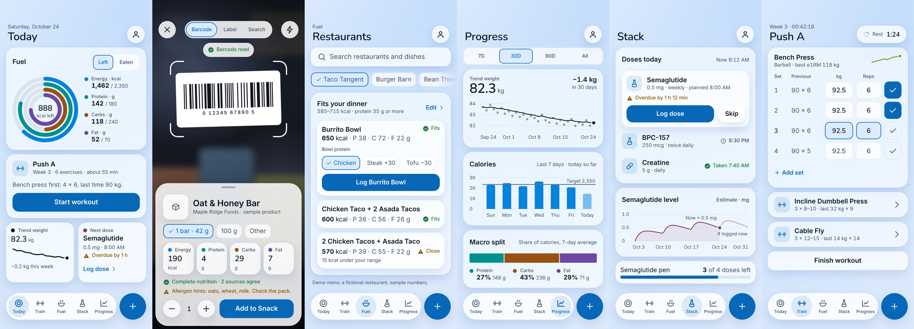

# Helios design system

Two themes from one set of tokens:

- **Graphite**, the dark theme: a transparent grey-and-black look. Near-black canvas, faint steel-blue ambient light, cards of translucent white glass.
- **Frost**, the light theme: white and light blue. Pale blue canvas, frosted white glass, one blue accent.




Open `design/lookbook/index.html` in a browser for the full look book: six screens per theme, both palette sheets, and the same components under Reduce Transparency and Increase Contrast. Every figure in it is sample data. The restaurant numbers are real `RestaurantCore` output over the fictional demo menu.

> **What this is, and is not.** The look book is HTML and CSS drawn from the same tokens the Swift package uses. It shows the intended look; it is not a screenshot of the app. The SwiftUI layer is now inspected in both themes on an iPhone simulator. See [native look-book alignment](LOOKBOOK_ALIGNMENT.md) for captures and the remaining physical-device checks.

## 1. How it is built

`design/tokens.json` is the only place a colour, radius, spacing step or type role is written down. Everything else is generated or checked against it.

| File | Role |
| --- | --- |
| `design/tokens.json` | The source. Four palettes (each theme plus its Increase Contrast variant), glass spec, radii, spacing, type roles, motion, chart groups. |
| `scripts/gen_tokens.py` | Validates the tokens and writes the two files below. `--check` fails when they are stale. |
| `Packages/HeliosDesign/.../GeneratedTokens.swift` | The palettes as Swift values. |
| `design/tokens.css` | The same values as CSS variables, scoped to `[data-theme]` and `[data-contrast]` on any element. |
| `Packages/HeliosDesign` | `ColorMath` (WCAG, OKLab, colour-blindness simulation), `PaletteAudit`, and the SwiftUI layer. |
| `design/lookbook/` | The look book: `look.css` composes the tokens into screens. |
| `scripts/check_lookbook.py` | Fails when the look book uses a token that does not exist, hard-codes a colour, or prints a hex code or contrast ratio that tokens.json does not back up. |
| `scripts/lint_dynamic_type.py` | Fails on text with a fixed point size. |

To change the look: edit `tokens.json`, run `python3 scripts/gen_tokens.py`, run `swift test` in `Packages/HeliosDesign`, and commit everything together. CI runs the generator check, the look-book check, the script tests, the Dynamic Type lint, and every Swift package on two Xcode toolchains.

## 2. The two themes

| | Graphite | Frost |
| --- | --- | --- |
| Canvas | `#0A0B0E` to `#15171C` | `#F7FAFF` to `#E3EDFA` |
| Ambient light | `#4F6489` at 20%, `#3A4256` at 14% | `#7FB6F5` at 40%, `#BCD8FB` at 50% |
| Glass: base, raised, overlay | white 5%, 8%, 11% | white 62%, 74%, 86% |
| Opaque fallback | `#212327`, `#282A2E`, `#2F3135` | `#F4F8FD`, `#F8FAFE`, `#FBFCFE` |
| Edge, top-left to bottom-right | white 20% to 6% | white 95% to 55% |
| Shadow | black 45%, blur 24, y 12 | blue 14%, blur 24, y 10 |
| Text: primary, secondary, tertiary | `#F5F7FA`, `#C4CAD4`, `#A8B1BE` | `#0B1626`, `#41536B`, `#566780` |
| Accent (label on it) | `#8AD0FF` (`#06131F`) | `#0868B8` (`#FFFFFF`) |
| Success, warning, danger | `#6FD08C`, `#F2C14E`, `#FFA198` | `#1E7A3C`, `#8A5A00`, `#B3261E` |

Series colours keep one meaning everywhere (a macro is the same colour in a ring, a bar and a legend):

| Series | Graphite | Frost |
| --- | --- | --- |
| Energy | `#3D96F5` | `#0383DD` |
| Protein | `#31AA9A` | `#03918E` |
| Carbs | `#C07E15` | `#975110` |
| Fat | `#927CE9` | `#6E47A4` |
| Training | `#82960E` | `#738C0A` |
| Peptide | `#D66A9E` | `#8C376B` |
| Weight | `#F5F7FA` | `#0B1626` |
| Reference line | `#939CAA` | `#5F7089` |

### How glass is built

The HTML reference uses a backdrop blur. Native cards sit over the already-soft static canvas and use the palette's glass tint directly, with a 1 pt lit edge and soft shadow. Full-strength system material added a neutral gray wash on current iOS, which drifted from the reference. Floating overlays retain a restrained system ultra-thin material at 15% opacity beneath their tint. Reduce Transparency uses the existing fully opaque palette; Increase Contrast keeps its strong edge. No palette values changed in this alignment pass.

- **Base** is a card sitting on the canvas. **Raised** is a tile or control on a card. **Overlay** is anything that floats: the tab bar, sheets, menus.
- Glass inside glass only tints. There is nothing new behind it to blur.
- Camera screens are the exception to theming: controls are glass, but the viewfinder marks are white on video in both themes.

## 3. Rules that keep it readable

These are enforced by `PaletteAudit` (Swift tests, run in CI) and cross-checked by `check_lookbook.py`.

**Contrast.** Every text colour is held to 4.5:1 on every glass level, composited over every backdrop the glass can meet: both canvas ends, each glow, and all glows stacked. Worst cases:

| | Graphite | Frost |
| --- | --- | --- |
| Primary, secondary, tertiary text | 9.4, 6.2, 4.7 | 15.7, 6.8, 5.0 |
| Accent, success, warning, danger as text | 6.1, 5.4, 6.0, 5.2 | 4.9, 4.7, 5.1, 5.7 |
| Label on the accent button | 11.2 | 5.7 |
| Series colours as graphics (3:1 needed) | 3.0 to 3.6 | 3.3 to 6.3 |

- Primary and secondary text are also checked on the bare canvas, where screen titles sit: 13.4 and 8.7 on Graphite, 12.3 and 5.3 on Frost.
- **Put coloured text, tertiary text and chart marks on cards**, not on bare canvas. On Frost the canvas is darkest under its blue glow and any glass over it is lighter, so text that passes on glass can fall short on bare canvas: accent and status text drop to about 3.6 to 4.4 there.
- Keep data marks on base cards. A raised tile inside a card stacks two tints and is lighter than anything the audit measured, which matters for the series colours that sit close to 3:1 in Graphite.

**Colour is never the only signal.** Status pairs a colour with an icon and words. Selection is a border, a fill and a check mark. Series are named in a legend or direct label.

**Chart colours.** Series that can share a chart are checked pair by pair (OKLab distance ×100): at least 15 apart for normal vision and at least 8 under protanopia and deuteranopia, with tritanopia reported as a warning. Each series must also sit in a lightness band (OKLCH 0.48 to 0.67 on dark, 0.43 to 0.77 on light) and keep chroma of at least 0.10 so it reads as a colour, not grey. The groups are macros (protein, carbs, fat) and the lifeline (energy, training, peptide). Closest pairs are 20.0 and 23.7 on Graphite, 22.0 and 25.6 on Frost. All four also pass the dataviz skill's own validator.

**Chart marks.** Bars are at most 24 thick with a 4 radius at the data end and a square base; lines are 2; markers are at least 8 across with a 2 ring in the surface colour; areas are a 10% wash; gridlines are solid hairlines; stacked segments are separated by a 2 gap. Label the end point or the extreme, never every point. One filter row sits above the charts it scopes.

**Reduce Transparency.** Glass becomes the opaque fallback of the same tone, with no blur. Layout and contrast do not change.

**Increase Contrast.** Separate palettes: the glass tint is retuned (Graphite 3, 5, 7%; Frost 80, 88, 94%), every glass edge becomes a 1.5 pt line at 70% (at least 3:1), and secondary and tertiary text get stronger.

**Dynamic Type.** Text is written only through the type roles (`heliosFont(.metricValue)`), which are text styles, so a fixed point size cannot be expressed. Sizes that are not fonts use `@ScaledMetric`. The lint fails the build on `.font(.system(size:))`, `fixedSize`, and UIKit fonts without `UIFontMetrics`, and warns on `.dynamicTypeSize` caps, `minimumScaleFactor` and `lineLimit(1)`. `MetricTile` moves its unit below the value when the text is large.

**Touch targets.** At least 44 pt everywhere; workout controls are 48. Chips keep a compact fill with a 44 pt tap area.

## 4. Using it in the app

Apply the theme once at the root, below any `preferredColorScheme`, and draw the canvas behind everything:

```swift
import HeliosDesign

struct RootView: View {
    var body: some View {
        ZStack {
            HeliosBackground()
            TodayScreen()
        }
        .heliosThemed()
    }
}

struct FuelCard: View {
    @Environment(\.heliosTheme) private var theme

    var body: some View {
        VStack(alignment: .leading, spacing: HeliosTokens.space(3)) {
            SectionHeader("Fuel")
            MetricTile("Protein", value: "142", unit: "g", accent: theme.palette.data.protein.color)
            Button("Start workout") {}.buttonStyle(.heliosPrimary)
        }
        .glassCard()
    }
}
```

The snippet is illustrative and has not been compiled.

Each look-book piece has a counterpart:

| Look book | SwiftUI |
| --- | --- |
| `.glass`, `.glass.raised`, `.glass.overlay` | `.glassCard(level:)`, `GlassBackground(level:cornerRadius:)` |
| Metric tile | `MetricTile` |
| Primary and secondary button | `.buttonStyle(.heliosPrimary)`, `.heliosSecondary` |
| Chip | `HeliosChip` |
| Status badge | `StatusBadge` |
| Ring | `ProgressRing` (one ring; compose four for Today) |
| Type classes `.t-hero` to `.t-tab` | `heliosFont(.hero)` to `heliosFont(.tab)` |
| Chart axes and series colours | `heliosChartStyle()`, `palette.data.chartRange(for:)` |
| Whole kit, for review on a device | `HeliosGallery` |

Not built yet, but drawn in the look book: the floating tab bar with its detached Quick Log button, the segmented control, the search field, the set-entry rows, the meter, the camera viewfinder and result sheet, and the chart marks to the specs above.

In Xcode, check the gallery with Reduce Transparency, Increase Contrast and the largest accessibility text size switched on. Run `python3 scripts/lint_dynamic_type.py App` once the app folder exists; it is the quickest way to find the text that fails the "largest Dynamic Type" accessibility audit.

## 5. What is verified, and what is not

Verified:

- Contrast, colour-blindness separation, lightness bands and edge visibility, for all four palettes: 30 Swift tests under Swift 5.10 and 6.1, and an independent Python recomputation of every ratio printed on the palette sheets.
- The look book rendered in Chromium at 390 by 844 in both themes and under both accessibility modes, with checks for overflow and small tap targets.
- The SwiftUI layer compiles on macOS CI (Xcode 15.4 and the latest).

Not verified:

- How the SwiftUI layer looks on a device or simulator: blur strength, ring drawing, behaviour at the largest text size, VoiceOver order.
- The fonts. The look book falls back to Inter and Nunito outside Apple platforms; the app uses SF Pro and SF Rounded.
- Colour on real displays, and under real colour-vision deficiency rather than simulation.

## 6. Decisions to revisit

- **iOS 26 Liquid Glass.** `glassEffect()` could replace the material and tint. It is left out because the deployment floor is iOS 17 and system glass cannot be audited numerically. Revisit when the floor moves.
- **Tertiary text** was first set at 3:1 and is now held to 4.5:1 like every other text colour; the first draft failed WCAG AA for real text.
- **The name Helios** still needs trademark clearance.
