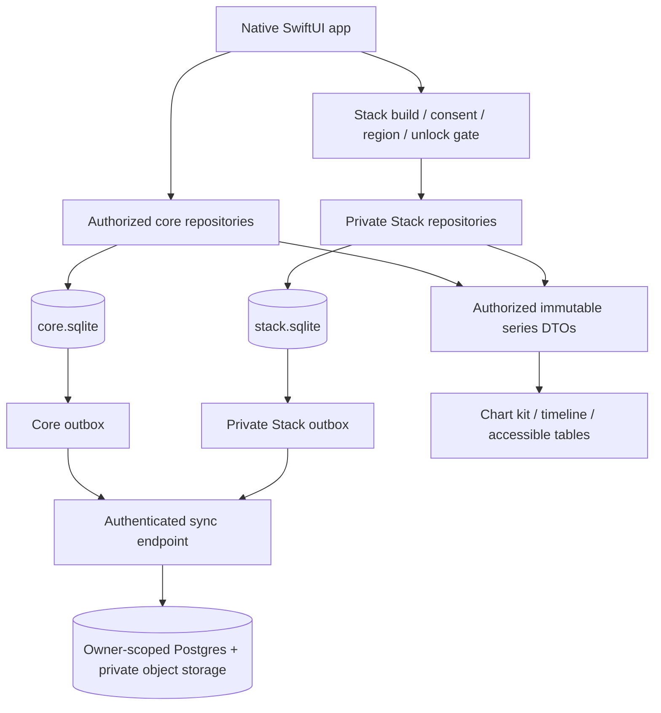

# Storage map

Proposed v1: two independent databases. Neither diagram represents an already-migrated application. Full entity/FK diagrams are in [ERD_CORE](ERD_CORE.md) and [ERD_STACK](ERD_STACK.md); every column/constraint is in the SQL and `architecture/schema/TABLES.json`.

Core families: identity/settings/consent; exercise/equipment/muscles; routines/program days; workouts/sets/revisions/records; food provenance/servings/nutrients/menu components; meal and food snapshots/recipes/templates/hydration; targets/day completeness/safety; weigh-ins/measurements/check-ins/Health; attachments/notes/goals; registry/rollups/insight cache; import/export/sync.

Stack families: independent identity/settings/consent; compounds and cited neutral references; versioned protocols/steps/immutable schedules; occurrences and exact dose revisions; vials/components/inventory movements; syringe calibration/calculator inputs; sites/symptoms/attachments; private registry/rollups/insights/export/sync.

The timeline merges authorized projections in memory; core has no Stack foreign key or persisted dose cache. One user's health records can never reference another user's object. Generic attachment/event owners are restricted to same-store allowlisted tables with existence checks.

Full P1 models such as lab panels, mesocycles and subscription records will be additive later migrations. Their backlog is preserved; no fake P0 screen is declared done because an empty table exists.
