# Core v1 entity relationships

Generated from the delivered table manifest. `||` means required parent, `|o` optional; many-side children are `o{`. All non-account entities additionally belong to an account. See SQL for fields and CHECK constraints.

```mermaid
erDiagram
    accounts {
        UUIDv7 id PK
    }
    devices {
        UUIDv7 id PK
        UUIDv7 account_id FK
    }
    settings {
        UUIDv7 id PK
        UUIDv7 account_id FK
    }
    consents {
        UUIDv7 id PK
        UUIDv7 account_id FK
    }
    sync_outbox {
        UUIDv7 id PK
        UUIDv7 account_id FK
    }
    sync_cursors {
        UUIDv7 id PK
        UUIDv7 account_id FK
    }
    sync_conflicts {
        UUIDv7 id PK
        UUIDv7 account_id FK
    }
    attachments {
        UUIDv7 id PK
        UUIDv7 account_id FK
    }
    series_registry {
        UUIDv7 id PK
        UUIDv7 account_id FK
    }
    event_registry {
        UUIDv7 id PK
        UUIDv7 account_id FK
    }
    events {
        UUIDv7 id PK
        UUIDv7 account_id FK
    }
    daily_rollups {
        UUIDv7 id PK
        UUIDv7 account_id FK
    }
    chart_preferences {
        UUIDv7 id PK
        UUIDv7 account_id FK
    }
    notification_jobs {
        UUIDv7 id PK
        UUIDv7 account_id FK
    }
    muscles {
        UUIDv7 id PK
        UUIDv7 account_id FK
    }
    equipment {
        UUIDv7 id PK
        UUIDv7 account_id FK
    }
    gyms {
        UUIDv7 id PK
        UUIDv7 account_id FK
    }
    plate_inventory {
        UUIDv7 id PK
        UUIDv7 account_id FK
    }
    exercises {
        UUIDv7 id PK
        UUIDv7 account_id FK
    }
    exercise_aliases {
        UUIDv7 id PK
        UUIDv7 account_id FK
    }
    exercise_muscles {
        UUIDv7 id PK
        UUIDv7 account_id FK
    }
    exercise_equipment {
        UUIDv7 id PK
        UUIDv7 account_id FK
    }
    set_types {
        UUIDv7 id PK
        UUIDv7 account_id FK
    }
    routine_folders {
        UUIDv7 id PK
        UUIDv7 account_id FK
    }
    routines {
        UUIDv7 id PK
        UUIDv7 account_id FK
    }
    routine_exercises {
        UUIDv7 id PK
        UUIDv7 account_id FK
    }
    routine_sets {
        UUIDv7 id PK
        UUIDv7 account_id FK
    }
    training_schedule {
        UUIDv7 id PK
        UUIDv7 account_id FK
    }
    workouts {
        UUIDv7 id PK
        UUIDv7 account_id FK
    }
    workout_exercises {
        UUIDv7 id PK
        UUIDv7 account_id FK
    }
    workout_sets {
        UUIDv7 id PK
        UUIDv7 account_id FK
    }
    set_revisions {
        UUIDv7 id PK
        UUIDv7 account_id FK
    }
    rest_timers {
        UUIDv7 id PK
        UUIDv7 account_id FK
    }
    pr_records {
        UUIDv7 id PK
        UUIDv7 account_id FK
    }
    muscle_targets {
        UUIDv7 id PK
        UUIDv7 account_id FK
    }
    food_sources {
        UUIDv7 id PK
        UUIDv7 account_id FK
    }
    restaurants {
        UUIDv7 id PK
        UUIDv7 account_id FK
    }
    foods {
        UUIDv7 id PK
        UUIDv7 account_id FK
    }
    food_servings {
        UUIDv7 id PK
        UUIDv7 account_id FK
    }
    nutrients {
        UUIDv7 id PK
        UUIDv7 account_id FK
    }
    food_nutrients {
        UUIDv7 id PK
        UUIDv7 account_id FK
    }
    food_component_groups {
        UUIDv7 id PK
        UUIDv7 account_id FK
    }
    food_components {
        UUIDv7 id PK
        UUIDv7 account_id FK
    }
    meal_slots {
        UUIDv7 id PK
        UUIDv7 account_id FK
    }
    meal_logs {
        UUIDv7 id PK
        UUIDv7 account_id FK
    }
    food_logs {
        UUIDv7 id PK
        UUIDv7 account_id FK
    }
    food_log_nutrients {
        UUIDv7 id PK
        UUIDv7 account_id FK
    }
    recipes {
        UUIDv7 id PK
        UUIDv7 account_id FK
    }
    recipe_ingredients {
        UUIDv7 id PK
        UUIDv7 account_id FK
    }
    meal_templates {
        UUIDv7 id PK
        UUIDv7 account_id FK
    }
    meal_template_items {
        UUIDv7 id PK
        UUIDv7 account_id FK
    }
    hydration_logs {
        UUIDv7 id PK
        UUIDv7 account_id FK
    }
    supplement_logs {
        UUIDv7 id PK
        UUIDv7 account_id FK
    }
    safety_acknowledgements {
        UUIDv7 id PK
        UUIDv7 account_id FK
    }
    nutrition_targets {
        UUIDv7 id PK
        UUIDv7 account_id FK
    }
    target_overrides {
        UUIDv7 id PK
        UUIDv7 account_id FK
    }
    diet_phases {
        UUIDv7 id PK
        UUIDv7 account_id FK
    }
    weigh_ins {
        UUIDv7 id PK
        UUIDv7 account_id FK
    }
    measurements {
        UUIDv7 id PK
        UUIDv7 account_id FK
    }
    check_ins {
        UUIDv7 id PK
        UUIDv7 account_id FK
    }
    health_samples {
        UUIDv7 id PK
        UUIDv7 account_id FK
    }
    health_anchors {
        UUIDv7 id PK
        UUIDv7 account_id FK
    }
    goals {
        UUIDv7 id PK
        UUIDv7 account_id FK
    }
    notes {
        UUIDv7 id PK
        UUIDv7 account_id FK
    }
    import_batches {
        UUIDv7 id PK
        UUIDv7 account_id FK
    }
    legacy_id_map {
        UUIDv7 id PK
        UUIDv7 account_id FK
    }
    export_jobs {
        UUIDv7 id PK
        UUIDv7 account_id FK
    }
    programs {
        UUIDv7 id PK
        UUIDv7 account_id FK
    }
    program_days {
        UUIDv7 id PK
        UUIDv7 account_id FK
    }
    cached_insights {
        UUIDv7 id PK
        UUIDv7 account_id FK
    }
    nutrition_days {
        UUIDv7 id PK
        UUIDv7 account_id FK
    }
    sync_context {
        UUIDv7 id PK
        UUIDv7 account_id FK
    }
    accounts ||--o{ devices : owns
    accounts ||--o{ settings : owns
    accounts ||--o{ consents : owns
    accounts ||--o{ sync_outbox : owns
    accounts ||--o{ sync_cursors : owns
    accounts ||--o{ sync_conflicts : owns
    accounts ||--o{ attachments : owns
    accounts ||--o{ series_registry : owns
    accounts ||--o{ event_registry : owns
    accounts ||--o{ events : owns
    event_registry ||--o{ events : event_type_id
    accounts ||--o{ daily_rollups : owns
    series_registry ||--o{ daily_rollups : series_id
    accounts ||--o{ chart_preferences : owns
    accounts ||--o{ notification_jobs : owns
    accounts ||--o{ muscles : owns
    muscles |o--o{ muscles : parent_id
    accounts ||--o{ equipment : owns
    accounts ||--o{ gyms : owns
    accounts ||--o{ plate_inventory : owns
    gyms ||--o{ plate_inventory : gym_id
    accounts ||--o{ exercises : owns
    equipment |o--o{ exercises : default_bar_id
    exercises |o--o{ exercises : merged_into_id
    accounts ||--o{ exercise_aliases : owns
    exercises ||--o{ exercise_aliases : exercise_id
    accounts ||--o{ exercise_muscles : owns
    exercises ||--o{ exercise_muscles : exercise_id
    muscles ||--o{ exercise_muscles : muscle_id
    accounts ||--o{ exercise_equipment : owns
    exercises ||--o{ exercise_equipment : exercise_id
    equipment ||--o{ exercise_equipment : equipment_id
    gyms |o--o{ exercise_equipment : gym_id
    accounts ||--o{ set_types : owns
    accounts ||--o{ routine_folders : owns
    accounts ||--o{ routines : owns
    routine_folders |o--o{ routines : folder_id
    accounts ||--o{ routine_exercises : owns
    routines ||--o{ routine_exercises : routine_id
    exercises ||--o{ routine_exercises : exercise_id
    accounts ||--o{ routine_sets : owns
    routine_exercises ||--o{ routine_sets : routine_exercise_id
    set_types ||--o{ routine_sets : set_type_id
    accounts ||--o{ training_schedule : owns
    routines |o--o{ training_schedule : routine_id
    program_days |o--o{ training_schedule : program_day_id
    programs |o--o{ training_schedule : program_id
    accounts ||--o{ workouts : owns
    routines |o--o{ workouts : routine_id
    gyms |o--o{ workouts : gym_id
    workouts |o--o{ workouts : repeated_workout_id
    weigh_ins |o--o{ workouts : bodyweight_log_id
    program_days |o--o{ workouts : program_day_id
    accounts ||--o{ workout_exercises : owns
    workouts ||--o{ workout_exercises : workout_id
    exercises ||--o{ workout_exercises : exercise_id
    exercises |o--o{ workout_exercises : original_exercise_id
    equipment |o--o{ workout_exercises : equipment_id
    accounts ||--o{ workout_sets : owns
    workout_exercises ||--o{ workout_sets : workout_exercise_id
    set_revisions |o--o{ workout_sets : current_revision_id
    accounts ||--o{ set_revisions : owns
    workout_sets ||--o{ set_revisions : set_id
    set_revisions |o--o{ set_revisions : parent_revision_id
    devices ||--o{ set_revisions : writer_device_id
    set_types ||--o{ set_revisions : set_type_id
    accounts ||--o{ rest_timers : owns
    workouts ||--o{ rest_timers : workout_id
    workout_sets |o--o{ rest_timers : set_id
    accounts ||--o{ pr_records : owns
    exercises ||--o{ pr_records : exercise_id
    workouts ||--o{ pr_records : workout_id
    set_revisions |o--o{ pr_records : set_revision_id
    accounts ||--o{ muscle_targets : owns
    muscles ||--o{ muscle_targets : muscle_id
    accounts ||--o{ food_sources : owns
    accounts ||--o{ restaurants : owns
    accounts ||--o{ foods : owns
    food_sources ||--o{ foods : source_id
    restaurants |o--o{ foods : restaurant_id
    foods |o--o{ foods : corrected_from_id
    accounts ||--o{ food_servings : owns
    foods ||--o{ food_servings : food_id
    accounts ||--o{ nutrients : owns
    accounts ||--o{ food_nutrients : owns
    foods ||--o{ food_nutrients : food_id
    nutrients ||--o{ food_nutrients : nutrient_id
    accounts ||--o{ food_component_groups : owns
    foods ||--o{ food_component_groups : food_id
    accounts ||--o{ food_components : owns
    foods ||--o{ food_components : parent_food_id
    foods ||--o{ food_components : child_food_id
    food_component_groups |o--o{ food_components : group_id
    accounts ||--o{ meal_slots : owns
    accounts ||--o{ meal_logs : owns
    meal_slots ||--o{ meal_logs : meal_slot_id
    meal_logs |o--o{ meal_logs : copied_from_id
    accounts ||--o{ food_logs : owns
    meal_logs ||--o{ food_logs : meal_log_id
    foods |o--o{ food_logs : food_id
    food_servings |o--o{ food_logs : serving_id
    accounts ||--o{ food_log_nutrients : owns
    food_logs ||--o{ food_log_nutrients : food_log_id
    nutrients ||--o{ food_log_nutrients : nutrient_id
    accounts ||--o{ recipes : owns
    foods ||--o{ recipes : food_id
    accounts ||--o{ recipe_ingredients : owns
    recipes ||--o{ recipe_ingredients : recipe_id
    foods ||--o{ recipe_ingredients : food_id
    accounts ||--o{ meal_templates : owns
    meal_slots |o--o{ meal_templates : preferred_slot_id
    accounts ||--o{ meal_template_items : owns
    meal_templates ||--o{ meal_template_items : meal_template_id
    foods ||--o{ meal_template_items : food_id
    accounts ||--o{ hydration_logs : owns
    accounts ||--o{ supplement_logs : owns
    foods ||--o{ supplement_logs : food_id
    food_logs |o--o{ supplement_logs : food_log_id
    accounts ||--o{ safety_acknowledgements : owns
    accounts ||--o{ nutrition_targets : owns
    safety_acknowledgements |o--o{ nutrition_targets : clinician_ack_id
    nutrients |o--o{ nutrition_targets : nutrient_id
    accounts ||--o{ target_overrides : owns
    nutrition_targets ||--o{ target_overrides : base_target_id
    safety_acknowledgements |o--o{ target_overrides : clinician_ack_id
    accounts ||--o{ diet_phases : owns
    nutrition_targets |o--o{ diet_phases : target_id
    accounts ||--o{ weigh_ins : owns
    accounts ||--o{ measurements : owns
    accounts ||--o{ check_ins : owns
    weigh_ins |o--o{ check_ins : weigh_in_id
    accounts ||--o{ health_samples : owns
    accounts ||--o{ health_anchors : owns
    accounts ||--o{ goals : owns
    exercises |o--o{ goals : exercise_id
    muscles |o--o{ goals : muscle_id
    accounts ||--o{ notes : owns
    accounts ||--o{ import_batches : owns
    accounts ||--o{ legacy_id_map : owns
    import_batches ||--o{ legacy_id_map : batch_id
    accounts ||--o{ export_jobs : owns
    accounts ||--o{ programs : owns
    accounts ||--o{ program_days : owns
    programs ||--o{ program_days : program_id
    routines |o--o{ program_days : routine_id
    accounts ||--o{ cached_insights : owns
    accounts ||--o{ nutrition_days : owns
    accounts ||--o{ sync_context : owns
```

## Table responsibilities

| Table | Purpose |
|---|---|
| accounts | Local account root; an offline account works without a remote identity. |
| devices | Per-account sync writer identity; never a hardware advertising identifier. |
| settings | Typed preferences; key material belongs in Keychain, never this table. |
| consents | Append-only grant/revoke acknowledgements and permission history. |
| sync_outbox | Atomic, idempotent outbound mutation envelopes; health values stay in this store. |
| sync_cursors | Opaque cursor advances only in the same transaction as all applied pull changes. |
| sync_conflicts | Keep both remote and local candidates until an explicit deterministic or user resolution. |
| attachments | Encrypted-file manifest with a same-store typed owner; no image bytes in sync logs. |
| series_registry | Allowlisted query key and unit contract, never arbitrary executable SQL. |
| event_registry | Allowlisted event types for charts and the shared in-memory timeline. |
| events | Typed annotations; Stack events are never copied to the core database. |
| daily_rollups | Rebuildable per-series, local-day, dimension aggregates; missing values remain missing. |
| chart_preferences | Independent per-chart range, transforms, hidden numbers and marker preferences. |
| notification_jobs | Local schedule state; fixed IDs allow cancel/reschedule without duplicate alerts. |
| muscles | Body-map region taxonomy and original/license metadata. |
| equipment | Searchable equipment and bar definition; masses are canonical kg. |
| gyms | Gym profile and active plate calculator context. |
| plate_inventory | Integer plate counts per gym; matched pairs and fractional plates remain exact entered values. |
| exercises | Original/licensed exercise definitions plus private custom records; merge preserves old IDs. |
| exercise_aliases | Indexed aliases include user names without rewriting historical exercise IDs. |
| exercise_muscles | Fractional muscle attribution used by set counting and swap ranking. |
| exercise_equipment | Equipment requirements and optional per-gym setup notes. |
| set_types | User-defined set labels and independent volume/hard-set/PR inclusion switches. |
| routine_folders | Routine organization without deleting archived history. |
| routines | Reusable routine definition; program position can use these routine days before P1 programming. |
| routine_exercises | Ordered routine steps, superset/circuit groups and per-exercise defaults. |
| routine_sets | Editable target sets and warm-up ramps, expressed without programme prose. |
| training_schedule | Calendar plan, rest days, RRULE, missed handling and automatic programme position. |
| workouts | Durable resumable session identity and subjective finish summary. |
| workout_exercises | Session exercise ordering and grouping; swapping records both original and selected exercise. |
| workout_sets | Stable set identity; the selected immutable revision is the current projection. |
| set_revisions | Append-only complete set snapshots. Branches are preserved rather than silently overwriting. |
| rest_timers | Persisted timer deadlines survive app termination; notifications schedule from ends_at. |
| pr_records | Rebuildable records linked to the exact set revision and documented calculation method. |
| muscle_targets | User-set weekly neutral target bands, not clinical recommendations. |
| food_sources | Dataset licensing, attribution, provenance and freshness. |
| restaurants | Preserves the current restaurant library identity during shadow copy. |
| foods | Canonical per-100g food definitions; private corrections link to the original food. |
| food_servings | Household measures, default serving and exact input display units. |
| nutrients | Versioned nutrient identifiers with their actual canonical dimension and reference source. |
| food_nutrients | Per-100g values with source units retained; missing is not zero. |
| food_component_groups | Existing customizable restaurant builder groups; unrelated to dose units. |
| food_components | Restaurant options/modifier references and explicit portion capabilities. |
| meal_slots | Four initial slots plus unlimited private slots and local times. |
| meal_logs | Meal-level notes, photos, hunger/mood, planned/eaten state and clone provenance. |
| food_logs | Immutable-source nutrition snapshot editable only for this log; preserves exact serving entry. |
| food_log_nutrients | Micronutrient and supplement snapshots for diary totals independent of future catalog edits. |
| recipes | Recipe provenance, portions and explicit raw/cooked mass yield. |
| recipe_ingredients | Ordered ingredient mass and entered units for deterministic recipe totals. |
| meal_templates | Saved meal identity, independent from logs or originals. |
| meal_template_items | Reusable ordered meal portions. |
| hydration_logs | Water, caffeine and alcohol quick logs with canonical volume/mass and beverage calories. |
| supplement_logs | Non-peptide supplement log; amounts are food mass and optional nutrients, not injection protocols. |
| safety_acknowledgements | Immutable explicit acknowledgements; no silent floor overrides. |
| nutrition_targets | Calculated/default target snapshots with safety inputs, BMR method and entered goal rate. |
| target_overrides | Per-day or weekday targets and weekly flex budget with the same safety gates. |
| diet_phases | Cut/bulk/maintenance, refeed and diet-break schedule; no dose references. |
| weigh_ins | Canonical kg and original entered representation, including Health source identity. |
| measurements | Named/custom circumference or composition measurement with method and location. |
| check_ins | Current progress notes/photos and subjective recovery scores; optional weight linkage. |
| health_samples | Deduplicated provider observations for weight/steps P0 and recovery P1. |
| health_anchors | Per-type incremental Health cursor; saved atomically with samples/deletions. |
| goals | Cross-domain goal lines and dated targets; core accepts no Stack domain data. |
| notes | Dated private annotations with typed references to core entities only. |
| import_batches | Dry-run/reconciliation manifest for external formats and non-destructive SwiftData shadow copies. |
| legacy_id_map | Stable UUIDv4/SwiftData identity to UUIDv7 translation, without changing the source store. |
| export_jobs | Private full-fidelity JSON/CSV bundle manifests and deletion-request handoff status. |
| programs | Program identity needed to start/resume a programme day; generic user-authored structure only. |
| program_days | Ordered programme day points to its routine without copying authored programme text. |
| cached_insights | Rebuildable deterministic insight facts with exact input provenance for the Why sheet. |
| nutrition_days | Explicit day-completeness status; a food entry alone does not establish a complete day. |
| sync_context | Private transaction-scoped remote-apply suppression; must reset before commit. |
