# Stack v1 entity relationships

Generated from the delivered table manifest. `||` means required parent, `|o` optional; many-side children are `o{`. All non-account entities additionally belong to an account. See SQL for fields and CHECK constraints.

```mermaid
erDiagram
    accounts {
        UUIDv7 id PK
    }
    devices {
        UUIDv7 id PK
        UUIDv7 account_id FK
    }
    settings {
        UUIDv7 id PK
        UUIDv7 account_id FK
    }
    consents {
        UUIDv7 id PK
        UUIDv7 account_id FK
    }
    sync_outbox {
        UUIDv7 id PK
        UUIDv7 account_id FK
    }
    sync_cursors {
        UUIDv7 id PK
        UUIDv7 account_id FK
    }
    sync_conflicts {
        UUIDv7 id PK
        UUIDv7 account_id FK
    }
    attachments {
        UUIDv7 id PK
        UUIDv7 account_id FK
    }
    series_registry {
        UUIDv7 id PK
        UUIDv7 account_id FK
    }
    event_registry {
        UUIDv7 id PK
        UUIDv7 account_id FK
    }
    events {
        UUIDv7 id PK
        UUIDv7 account_id FK
    }
    daily_rollups {
        UUIDv7 id PK
        UUIDv7 account_id FK
    }
    chart_preferences {
        UUIDv7 id PK
        UUIDv7 account_id FK
    }
    notification_jobs {
        UUIDv7 id PK
        UUIDv7 account_id FK
    }
    compounds {
        UUIDv7 id PK
        UUIDv7 account_id FK
    }
    compound_references {
        UUIDv7 id PK
        UUIDv7 account_id FK
    }
    protocols {
        UUIDv7 id PK
        UUIDv7 account_id FK
    }
    protocol_revisions {
        UUIDv7 id PK
        UUIDv7 account_id FK
    }
    protocol_steps {
        UUIDv7 id PK
        UUIDv7 account_id FK
    }
    schedule_rules {
        UUIDv7 id PK
        UUIDv7 account_id FK
    }
    schedule_times {
        UUIDv7 id PK
        UUIDv7 account_id FK
    }
    dose_occurrences {
        UUIDv7 id PK
        UUIDv7 account_id FK
    }
    dose_logs {
        UUIDv7 id PK
        UUIDv7 account_id FK
    }
    dose_revisions {
        UUIDv7 id PK
        UUIDv7 account_id FK
    }
    vials {
        UUIDv7 id PK
        UUIDv7 account_id FK
    }
    vial_components {
        UUIDv7 id PK
        UUIDv7 account_id FK
    }
    inventory_ledger {
        UUIDv7 id PK
        UUIDv7 account_id FK
    }
    injection_sites {
        UUIDv7 id PK
        UUIDv7 account_id FK
    }
    symptom_logs {
        UUIDv7 id PK
        UUIDv7 account_id FK
    }
    symptom_protocols {
        UUIDv7 id PK
        UUIDv7 account_id FK
    }
    syringes {
        UUIDv7 id PK
        UUIDv7 account_id FK
    }
    calculator_presets {
        UUIDv7 id PK
        UUIDv7 account_id FK
    }
    export_jobs {
        UUIDv7 id PK
        UUIDv7 account_id FK
    }
    cached_insights {
        UUIDv7 id PK
        UUIDv7 account_id FK
    }
    sync_context {
        UUIDv7 id PK
        UUIDv7 account_id FK
    }
    accounts ||--o{ devices : owns
    accounts ||--o{ settings : owns
    accounts ||--o{ consents : owns
    accounts ||--o{ sync_outbox : owns
    accounts ||--o{ sync_cursors : owns
    accounts ||--o{ sync_conflicts : owns
    accounts ||--o{ attachments : owns
    accounts ||--o{ series_registry : owns
    accounts ||--o{ event_registry : owns
    accounts ||--o{ events : owns
    event_registry ||--o{ events : event_type_id
    accounts ||--o{ daily_rollups : owns
    series_registry ||--o{ daily_rollups : series_id
    accounts ||--o{ chart_preferences : owns
    accounts ||--o{ notification_jobs : owns
    accounts ||--o{ compounds : owns
    accounts ||--o{ compound_references : owns
    compounds ||--o{ compound_references : compound_id
    accounts ||--o{ protocols : owns
    protocol_revisions |o--o{ protocols : current_revision_id
    accounts ||--o{ protocol_revisions : owns
    protocols ||--o{ protocol_revisions : protocol_id
    protocol_revisions |o--o{ protocol_revisions : parent_revision_id
    devices ||--o{ protocol_revisions : writer_device_id
    accounts ||--o{ protocol_steps : owns
    protocol_revisions ||--o{ protocol_steps : protocol_revision_id
    compounds ||--o{ protocol_steps : compound_id
    accounts ||--o{ schedule_rules : owns
    protocol_steps ||--o{ schedule_rules : protocol_step_id
    accounts ||--o{ schedule_times : owns
    schedule_rules ||--o{ schedule_times : schedule_rule_id
    accounts ||--o{ dose_occurrences : owns
    protocol_steps ||--o{ dose_occurrences : protocol_step_id
    schedule_rules ||--o{ dose_occurrences : schedule_rule_id
    dose_logs |o--o{ dose_occurrences : resolved_dose_id
    accounts ||--o{ dose_logs : owns
    compounds ||--o{ dose_logs : compound_id
    dose_occurrences |o--o{ dose_logs : occurrence_id
    dose_revisions |o--o{ dose_logs : current_revision_id
    accounts ||--o{ dose_revisions : owns
    dose_logs ||--o{ dose_revisions : dose_log_id
    dose_revisions |o--o{ dose_revisions : parent_revision_id
    devices ||--o{ dose_revisions : writer_device_id
    vials |o--o{ dose_revisions : vial_id
    injection_sites |o--o{ dose_revisions : site_id
    syringes |o--o{ dose_revisions : syringe_id
    accounts ||--o{ vials : owns
    accounts ||--o{ vial_components : owns
    vials ||--o{ vial_components : vial_id
    compounds ||--o{ vial_components : compound_id
    accounts ||--o{ inventory_ledger : owns
    vials ||--o{ inventory_ledger : vial_id
    compounds |o--o{ inventory_ledger : compound_id
    dose_revisions |o--o{ inventory_ledger : dose_revision_id
    inventory_ledger |o--o{ inventory_ledger : reverses_entry_id
    devices ||--o{ inventory_ledger : writer_device_id
    accounts ||--o{ injection_sites : owns
    accounts ||--o{ symptom_logs : owns
    dose_logs |o--o{ symptom_logs : dose_log_id
    accounts ||--o{ symptom_protocols : owns
    symptom_logs ||--o{ symptom_protocols : symptom_id
    protocols ||--o{ symptom_protocols : protocol_id
    accounts ||--o{ syringes : owns
    accounts ||--o{ calculator_presets : owns
    vials ||--o{ calculator_presets : vial_id
    syringes |o--o{ calculator_presets : syringe_id
    compounds |o--o{ calculator_presets : compound_id
    accounts ||--o{ export_jobs : owns
    consents ||--o{ export_jobs : consent_id
    accounts ||--o{ cached_insights : owns
    accounts ||--o{ sync_context : owns
```

## Table responsibilities

| Table | Purpose |
|---|---|
| accounts | Local account root; an offline account works without a remote identity. |
| devices | Per-account sync writer identity; never a hardware advertising identifier. |
| settings | Typed preferences; key material belongs in Keychain, never this table. |
| consents | Append-only grant/revoke acknowledgements and permission history. |
| sync_outbox | Atomic, idempotent outbound mutation envelopes; health values stay in this store. |
| sync_cursors | Opaque cursor advances only in the same transaction as all applied pull changes. |
| sync_conflicts | Keep both remote and local candidates until an explicit deterministic or user resolution. |
| attachments | Encrypted-file manifest with a same-store typed owner; no image bytes in sync logs. |
| series_registry | Allowlisted query key and unit contract, never arbitrary executable SQL. |
| event_registry | Allowlisted event types for charts and the shared in-memory timeline. |
| events | Typed annotations; Stack events are never copied to the core database. |
| daily_rollups | Rebuildable per-series, local-day, dimension aggregates; missing values remain missing. |
| chart_preferences | Independent per-chart range, transforms, hidden numbers and marker preferences. |
| notification_jobs | Local schedule state; fixed IDs allow cancel/reschedule without duplicate alerts. |
| compounds | Private user-created compound identity; no benefit, suggested dose or sourcing fields. |
| compound_references | Optional cited neutral reference facts. This migration inserts none. |
| protocols | Protocol/template identity with an explicit selected immutable revision. |
| protocol_revisions | Append-only history of protocol edits, pause/resume and user-authored step plans. |
| protocol_steps | User-entered compound amount and route at a date/position in a protocol revision. |
| schedule_rules | User schedules and DST/travel policy; rule generation belongs to the tested schedule engine. |
| schedule_times | Multiple chosen local times per schedule, independent of UTC offsets. |
| dose_occurrences | Materialized expected occurrence and notification state; no inferred recommended amount. |
| dose_logs | Stable logged-dose identity; all edits/deletions are new immutable revisions. |
| dose_revisions | Exact user-confirmed dose snapshots, site/reaction/check-in and audit history. |
| vials | Vial/pen/container lifecycle and label-entered dates. Remaining inventory is ledger-derived. |
| vial_components | Per-component initial exact amount supports blends without converting IU into mass. |
| inventory_ledger | Immutable signed inventory movements; corrections reverse old movements then append replacements. |
| injection_sites | User-managed body-map zones, side, route tags and avoid-zone notes. |
| symptom_logs | Symptom severity/onset and optional dose relationship; descriptive log only. |
| symptom_protocols | Many-to-many symptom/protocol association. |
| syringes | User-confirmed syringe/pen calibration; no assumed activity-to-mass equivalence. |
| calculator_presets | User-saved math inputs linked to one vial; calculation is rerun rather than storing authoritative advice. |
| export_jobs | Separately consented private Stack export; never included implicitly in a core export. |
| cached_insights | Rebuildable deterministic insight facts with exact input provenance for the Why sheet. |
| sync_context | Private transaction-scoped remote-apply suppression; must reset before commit. |
