# Native look-book alignment — 2026-10-28

## Plan

1. Compare the 16-page owner-supplied PDF against native captures.
2. Merge Claude's latest fixes into an isolated branch.
3. Align headers, surfaces, spacing, charts and exercise cards.
4. Preserve logging, editing, privacy gates and real calculations.
5. Run native flow/accessibility checks and package/static checks.
6. Inspect both themes, publish the branch and refresh the local preview.

## Reference and implementation

Source: `/Users/jcrock/Downloads/Helios Look Book.pdf` (16 pages).
SHA-256: `46505cdc38c77f5db44f461baf5046d7608e11b2ba5345d53c06043b903c3e5a`.
The PDF is a reference, not app instructions. Its sample values are not imported
into a real store. Complete implementation files are committed in this branch.

```text
Caliber (DEV)/
  Views/Navigation/{CaliberHeader,CaliberTabBar,QuickLogSheet}.swift
  Views/Foundation/TodayFoundationView.swift
  Views/Progress/{ProgressDashboardView,ProgressCards,WeightTrendChart}.swift
  Views/Train/{ActiveWorkoutView,TrainHomeView,ExerciseLibraryView}.swift
  Views/Restaurants/RestaurantListView.swift
  Views/Diary/{DiaryView,BarcodeFoodLookupView}.swift
  Views/FoodLibrary/FoodLibraryView.swift
  Views/Components/CaliberAppearance.swift
  Stack/StackHomeView.swift
  Services/ShowcaseUITestFixture.swift
Caliber (DEV)UITests/
  LookbookPolishUITests.swift
  CustomExerciseUITests.swift
  TrainProfileUITests.swift
  XCUIApplication+PrimaryNavigation.swift
Packages/HeliosDesign/Sources/HeliosDesign/SwiftUI/Glass.swift
scripts/{lint_foundation,test_ios}.py
```

The app now places rounded, scalable headings and the profile avatar on the same
row. Graphite cards retain the dark canvas instead of taking on the OS material's
gray wash. Frost uses the same palette with lighter surfaces. The floating dock
has a stronger bottom mask. Progress keeps three compact charts above the
existing photo/weight/notes timeline. Chart explanations remain available from an
information button. At accessibility text sizes, range controls use two columns
to keep labels together without shrinking text. Workout cards expand one at a time, preserve uncompleted
input when collapsed, and expose RPE/warm-up through Set options. Previous-set
weights use the existing history service and the current display unit.

Restaurant search, source status and custom items remain functional; pending
licensed menus remain pending. Scanner results use a full glass card while
retaining source/review/edit actions. No camera feed, provider consensus,
restaurant nutrition, dose forecast or e1RM was invented to imitate the PDF.

## Migrations

None. User data, schemas, keys, cloud services and provider flags are unchanged.
The seven-day screenshot fixture is DEBUG-only and uses an isolated in-memory
store. Normal launches do not seed it.

## Run and verify

```sh
python3 scripts/lint_foundation.py
python3 scripts/lint_dynamic_type.py --strict 'Caliber (DEV)' Packages
python3 scripts/gen_tokens.py --check
python3 scripts/check_lookbook.py
python3 scripts/verify_phase1.py
python3 -m unittest discover -s scripts -p 'test_*.py'
swift test --package-path Packages/HeliosDesign
swift test --package-path Packages/CaliberFoundation
python3 scripts/test_ios.py --output /tmp/caliber-lookbook-checks
```

Xcode: open `Caliber (DEV).xcodeproj`, select `Caliber (DEV)`, select an iPhone
simulator, then press **Run** (▶). Appearance is under **Profile → Settings**.
Use the normal launch to see your own saved data; screenshot tests intentionally
use fictional stores.

## Verification report

| Acceptance check | Result | Evidence |
| --- | --- | --- |
| Rounded header and inline avatar; Profile opens | PASS | `LookbookPolishUITests.testAvatarSharesTheHeadingAndProfileStillOpens` |
| Graphite/Frost primary screens and pushed routes render | PASS | Both theme walkthroughs, native captures below |
| Three compact Progress cards and method explanation | PASS | Native captures; `testProgressOverviewKeepsItsChartsAndMethodAccessible` |
| Collapsing exercises preserves unfinished input; RPE/warm-up reachable | PASS | `testCollapsingWorkoutCardsRetainsUncompletedInputAndOptions` |
| Custom exercise creation, saved set and library reuse | PASS | Both `CustomExerciseUITests` scenarios |
| Check-in add/edit/delete and notes-only without invented weight | PASS | Both `ProgressUITests` scenarios |
| Local goal calculation and completed workout history | PASS | Both `TrainProfileUITests` scenarios |
| Stack opt-in, compound creation and dose log | PASS | `StackUITests.testOptInAddCompoundAndLogDose` |
| Default clipping and AX5 Dynamic Type/clipping audits | PASS | Graphite, Frost, workout, scan result and AX5 walkthroughs; no new exclusions |
| Text grows rather than being capped | PASS | Measured paragraph heights: Progress 64.33→497.33pt; Profile and Restaurants 47.67→274.67pt |
| Native unit suite | PASS | 10 XCTest + 215 Swift Testing cases |
| Helios palette/package tests | PASS | 30 XCTest cases |
| Foundation packages | PASS | 10 XCTest + 113 Swift Testing declarations, including two optional full-dataset skips |
| Script tests and static checks | PASS | 130 Python tests; lint; 205 Swift files with zero typography findings; token/look-book and phase contracts |
| Schema/privacy/provider gates preserved | PASS | Diff review; no migration, secrets, new providers or flags |
| Physical iPhone, minimum supported iOS and runtime chart budgets | NOT VERIFIED | Separate release checks; current simulator does not prove these |

The broad native run first found three failures: the renamed exercise header's
test selector, loss of the displayed second decimal in weight, and a profile
helper that overscrolled a field while the keyboard was up. All three were
corrected; the six-test focused rerun passed. A final build of the avatar adjustment then
passed all 225 native unit cases and the avatar, workout and AX5 UI checks.
The two-column accessibility picker and bounded header icons then passed a final
avatar and full AX5 walkthrough. The earlier Swift Charts internal
hash-key crash did not recur after removing a custom goal annotation and keeping
the target label outside Chart. Workout column clipping was fixed and re-audited.
No audit issue was suppressed to obtain these results. Xcode 27 still emits
intermittent framework layout warnings during transitions; passing audits are
not a performance or device certification.

Compact logs and capture provenance are in `docs/evidence/lookbook-polish/`.
Screenshots are original simulator attachments with fictional health data.
Baseline captures come from Claude's screenshot branch for source commit
`116d46a` / run `40573329431`; timestamps/sample values can differ.

## Native comparison

| Screen | Earlier native capture | Aligned capture |
| --- | --- | --- |
| Today | 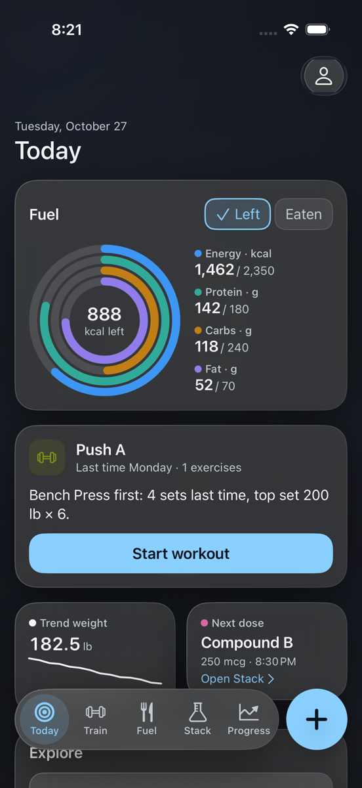 | 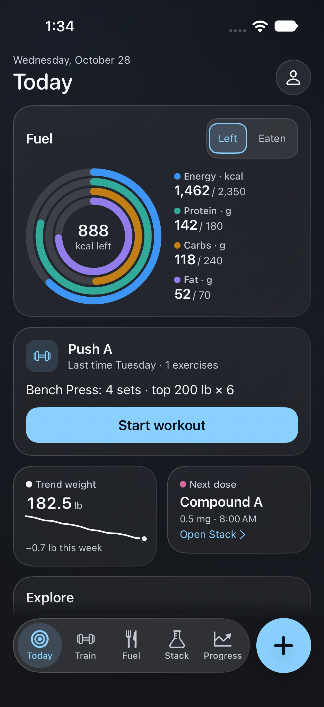 |
| Progress | 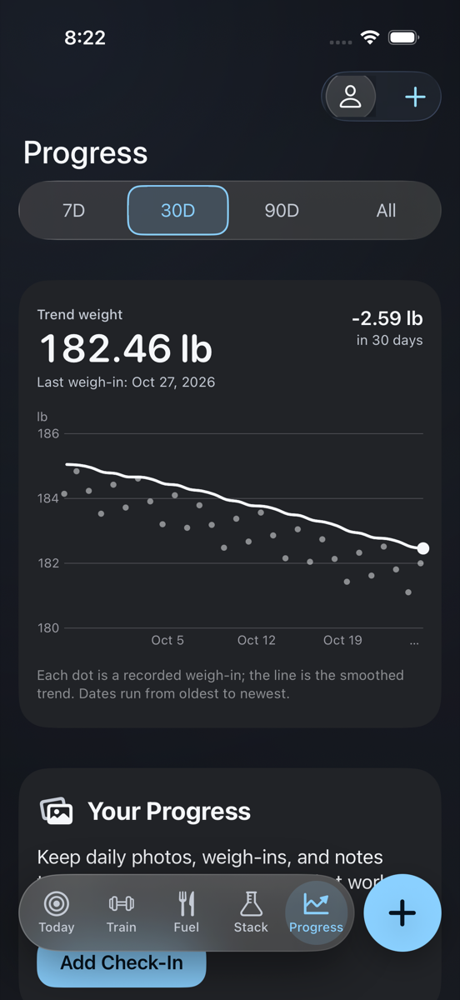 | 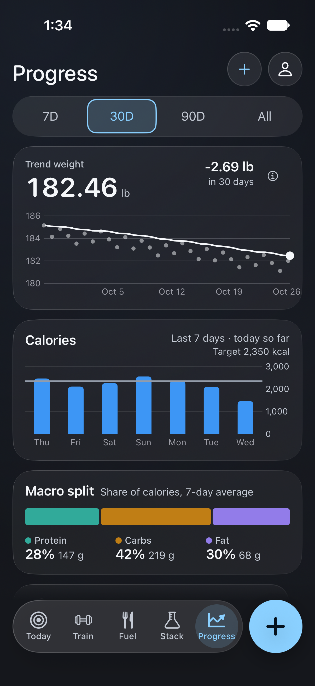 |
| Workout | 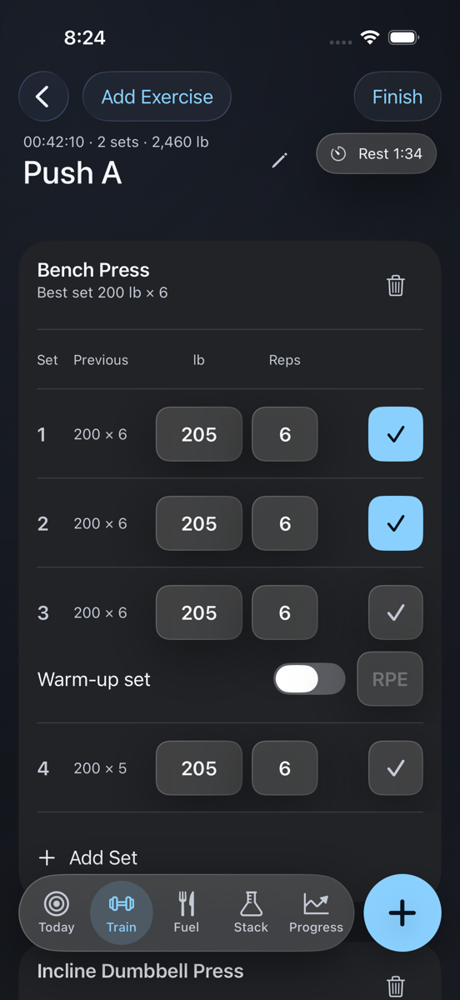 | 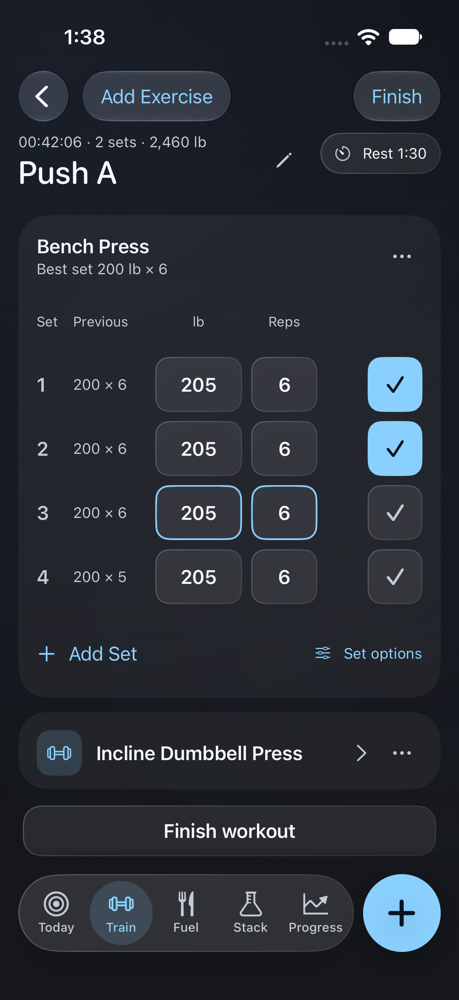 |

| Frost | Restaurants | Stack | Barcode result |
| --- | --- | --- | --- |
| 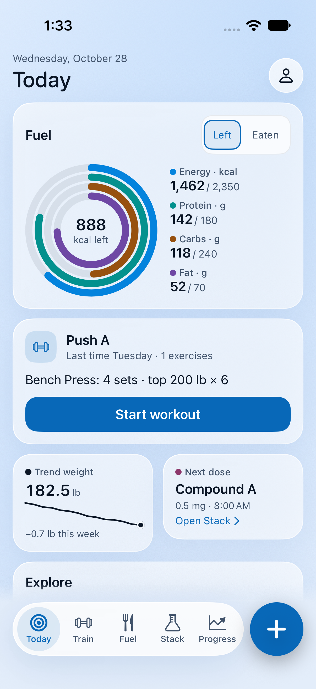 | 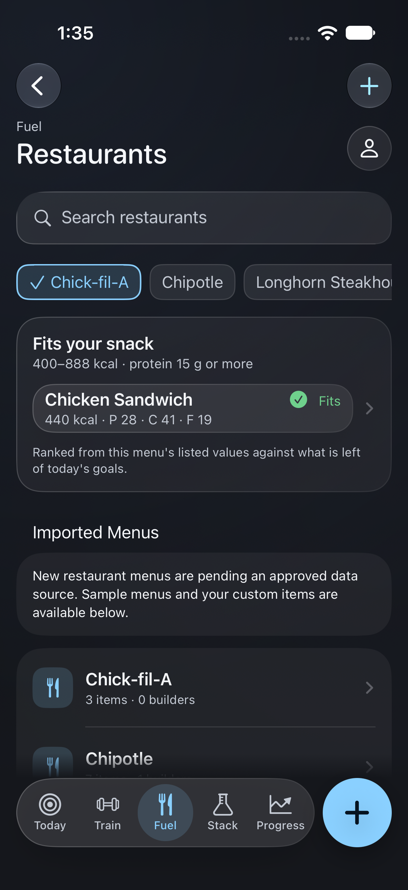 | 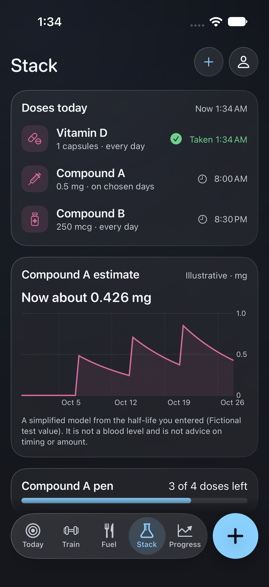 | 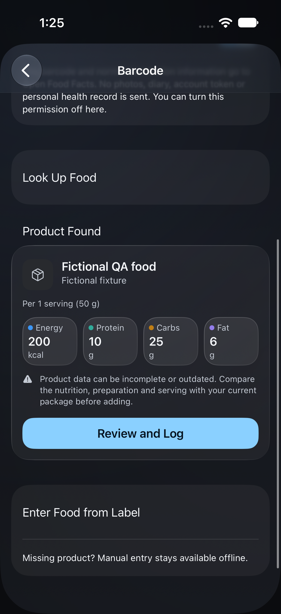 |

Native navigation retains system back/Add/Finish controls. A simulator cannot
provide a live camera viewfinder. Pending approved restaurant datasets are
explicitly identified, and existing illustrative Stack estimates keep their
scope text and opt-in gates. These functional differences from the concept are
intentional.

The local test device is an iPhone 17 simulator with iOS 27.0 / Xcode 27.1.
Physical camera, biometric hardware, minimum-iOS rendering and frame-time/memory
budgets require separate verification. This is visual alignment, not completion
of every P0 in the master brief or full accessibility certification.

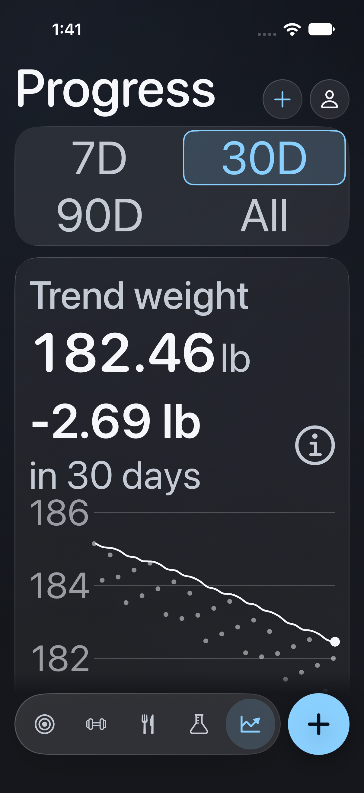

## Recommended next step

Review the local preview on an iPhone and compare the committed native captures
with the PDF. Continue with physical-device and minimum-iOS checks before release.
